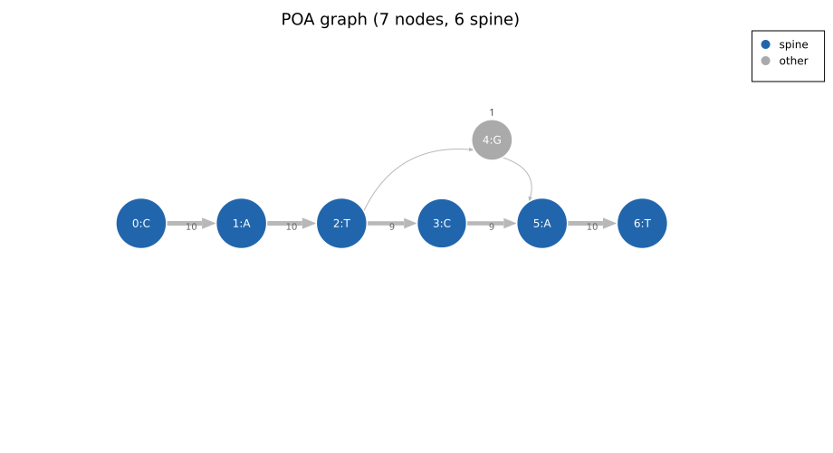
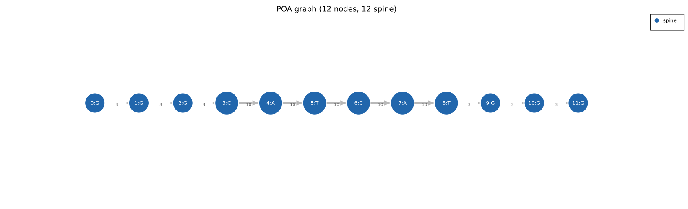
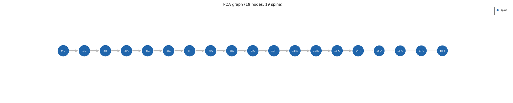
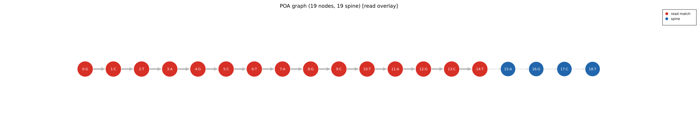

# Consensus Extraction

A single-allele call computes two candidate consensuses from the finished graph (heaviest
path and majority frequency), keeps the one the reads better support, and then tries
homopolymer-aware candidates inside homopolymer runs. Each step is described below.

## Heaviest path (heaviest bundling)

The heaviest path uses abPOA-style heaviest bundling. A reverse pass over the topologically
sorted graph picks, for every node, its **out-edge with the largest raw weight** (the
number of reads that took it), breaking ties by the larger downstream score; a node's score
is that edge's weight plus the chosen successor's score. The path starts at the
highest-scoring source node and follows the chosen edges to the end.

Because each step takes the heaviest out-edge, a single-read error branch (weight 1) never
beats a spine edge carried by most reads.

## Coverage floor and boundary trim

After the path is extracted, leading and trailing nodes below a coverage floor are trimmed.
The floor is:

```
min_coverage_fraction > 0:   floor = max(ceil(n_reads * min_coverage_fraction), 1)
min_coverage_fraction = 0:   floor = max(n_reads / 2 + 1, 2)     (strict majority)
```

`min_coverage_fraction` defaults to **0.0**, i.e. a strict majority of reads. A node's
coverage is the number of reads that matched it (deletes do not count).

Only the **ends** of the path are trimmed. This removes low-coverage flanks and
repeat-unit extensions supported by a minority of longer reads. There is no interior
filter: a low-coverage stretch inside the path (for example a region only one spanning read
covers) is kept and reported as a `CoverageGap`.

## Example: heaviest path with edge weight labels

In this fixture, 9 reads are `CATCAT` and 1 read has a G at position 3 (`CATGAT`). The
graph has a single-node arm (G) off the spine. Edge labels show the read count on each
edge: spine edges carry weight 9-10, the arm edges carry weight 1.

At the fork, the spine edge (weight 9) outweighs the arm edge (weight 1), so the heaviest
path follows the spine and ignores the single-read arm.



## Example: boundary trim with edge weight labels

Here, 3 reads span the full sequence `GGGCATCATGGG` (12 bp) and 7 reads cover only the
interior `CATCAT` (6 bp). With semi-global alignment (the default), the short reads take
free terminal gaps rather than forced deletions, so the GGG flank nodes accumulate
coverage only from the 3 spanning reads.

Edge labels show the read count: interior edges carry weight 10 (all reads), while the
flank edges carry weight 3. With 10 reads the strict-majority floor is 10 / 2 + 1 = 6, so
the flank nodes (coverage 3) fall below it and boundary trim removes them. The consensus is
`CATCAT`.



## Example: deletion graph

In this fixture, 10 reads have the full 19-base sequence and 3 reads carry a 2-base
deletion near the end. The heaviest path follows the 10-read spine (blue). The 3 deletion
reads take a skip edge (arc above the spine) over the deleted positions; that edge gains
weight, while the skipped nodes gain `del` counts but no coverage.



With a deletion read overlaid (orange), you can see which nodes the deleting read traverses
(skipping positions 15-16 via the arc edge):



## Majority frequency

The majority-frequency (MF) consensus reads the graph as a multiple alignment. Node fusion
already groups alternative bases into `aligned` sibling columns; these columns are put in
topological order, and each read is placed in the columns its path occupies. For every
column:

- **covering** = reads whose path starts at or before the column and ends at or after it;
- **present** = covering reads that actually occupy the column (any base);
- the column's genuine deletions are `covering - present`.

A column is emitted when `covering` reaches the coverage floor above **and** its plurality
base has more reads than the genuine deletions. A read that simply ends before a column
does not count as a deletion there, so partial reads cannot truncate a well-covered
column, while the floor still stops a minority of longer reads from emitting a private tail.

## Best fit (default)

`ConsensusMode::BestFit` builds both the heaviest-path and MF consensuses. If they differ,
each is scored against the reads: a throwaway graph is seeded with the candidate, every read
is aligned to it, and two totals are taken over all reads:

- **indel bases**: inserted plus deleted bases;
- **affine indel penalty**: each insert or delete run pays `|gap_open|` once, and each
  inserted or deleted base pays `|gap_extend|`.

Mismatches are **not** counted (on noisy reads they are mostly read error). MF replaces the
heaviest path only if it is strictly better on **both** totals; otherwise the heaviest path
is kept. Each total alone fails on repeats:

- A frame-broken candidate halfway between two repeat lengths (e.g. `(CA)19 C` when reads
  say 19 and 20 units) is one base from every read, so it has the fewest indel bases. It
  pays a gap open per read, so the affine penalty rejects it.
- When both candidates need the same indel bases, the affine penalty alone favours the
  shorter one: a read longer than the candidate can take several differences as one
  insertion run, saving an open. That turned correct `(CA)n` calls one unit short, and a
  homozygous `C6` HiFi call into `C5`. Requiring fewer indel bases too keeps the heaviest
  path on such ties. The two methods win on different inputs (heaviest path on
clean or short reads, MF on high-error length-variable repeats), so choosing per call gets
the better of both.

`ConsensusMode::MajorityFrequency` skips the comparison and always returns the MF
consensus, which suits high-depth amplicons where the column majority is trusted outright.
When MF output is returned, the per-position fields (`coverage`, `path_weights`, `gaps`)
are recomputed from the MF columns.

## Homopolymer handling

On by default for single-allele calls (`consensus`, `consensus_flanked`,
`bridged_consensus`). Defaults: `homopolymer_min_run = 2` and
`homopolymer_gap = Some((-2, -1))`; disable with `0` / `None` (CLI `--no-homopolymer`).

The plain engine consensus described above is built first. Then up to two homopolymer
candidates are built:

- a **compressed** consensus: runs of at least `homopolymer_min_run` identical bases become
  single "poly" symbols, a consensus is built in that space, and each run length is
  re-estimated from the reads;
- a **gap-cost** consensus: the normal engine with cheaper gap costs for indels inside a
  homopolymer on both the read and graph side, so a base shifted within a run aligns as
  indels rather than a mismatch pair, while a periodic repeat's unit indel keeps full cost.

Each candidate is spliced into the plain consensus **only where they differ inside
homopolymer runs**; everywhere else (e.g. a CAG repeat's unit count) the plain call is
kept. A splice is accepted only if it fits the reads **strictly better** than the plain
consensus, measured as mismatch plus indel bases per read base (mismatches count here,
unlike best fit, because a shifted base inside a run shows up as mismatches). Multi-allele
calls do not use homopolymer handling. See
[Single-Allele Consensus](../library/single-allele.md#homopolymer-handling) for usage.

## Tandem gap costs

Also on by default for single-allele calls (`tandem_gap = Some((-2, -1))`; `None` or CLI
`--tandem-gap off` to disable). It targets a heaviest-path error that depends on read
order: a read whose extra length belongs elsewhere (say a `CT` unit in a `(CT)n` flank)
aligns more cheaply by sliding across the repeat boundary with mismatches and reusing a
node another read inserted, so a wrong extra repeat unit can collect enough weight to
win.

During alignment, each read is scanned for locally periodic stretches: a 2-6 base unit
immediately followed by a copy of itself. An insertion of read bases inside such a
stretch, or a deletion of a node whose base belongs to the local unit, pays the tandem
`(open, extend)` instead of the normal gap costs. That makes a read's own unit slip
cheaper than the mismatch-and-reuse detour. No tract, unit or count is ever reported;
the test only prices one gap.

It is used for a third candidate, never the plain engine: the consensus is rebuilt with
tandem costs and replaces the plain call only if it fits the reads strictly better (the
same measure as the homopolymer splice, compared over the whole call). The candidate is
built only when the plain call has a base with support quality below 10, so loci where
the reads agree pay nothing. Applied to the plain engine without the guard, the same
costs pull genuine length splits toward the shorter length; as a guarded candidate they
fixed the order-dependent extra-unit calls without moving those splits.

## Semi-global alignment and boundary trim

With `AlignmentMode::SemiGlobal` (the default), partial reads take free terminal gaps rather
than forced delete traversals. A read that does not span the full locus therefore adds no
delete ops at the boundary nodes, leaving those nodes with genuinely low `coverage`, and
boundary trim removes them.

With `AlignmentMode::Global`, partial reads must traverse boundary nodes via deletes. This
does not increment `coverage`, but the alignment has a subtle failure at homopolymer-flanked
loci: shorter reads place their deletions inside the homopolymer run rather than at the
start. The extra node at the run boundary then sits on the only spine path with no
shortcut alternative, so boundary trim cannot reach it. The result is a consensus that takes the minority-depth path for those
leading bases.

**Use `SemiGlobal` for extracted STR reads. It is the default.**

## Output: `Consensus`

```rust
pub struct Consensus {
    pub sequence:     Vec<u8>,
    pub coverage:     Vec<u32>,      // per-position matched-read depth
    pub path_weights: Vec<i32>,      // incoming edge weight per base
    pub n_reads:      usize,
    pub graph_stats:  GraphStats,
    pub gaps:         Vec<CoverageGap>,
    pub bubble_sites: Vec<BubbleSite>,
    pub read_indices: Vec<usize>,    // populated by consensus_multi; empty otherwise
    pub support_quality: Vec<u8>,    // per-base support quality (Phred, capped at 60)
}
```

`coverage` and `path_weights` together describe confidence: a position where many reads
agreed (`path_weights` high) and coverage is at full depth is reliable. A position where
coverage drops (e.g. at a gap) is suspect. For the first base, and for MF output,
`path_weights` is derived from coverage because there is no single incoming path edge.

`support_quality` is the per-base summary of that confidence. For a heaviest-path call it
comes straight from the recorded read paths: each read's route into a base either follows
the consensus (agreement) or takes an alternative route, reads on the same route are
pooled, and each base is scored against its strongest alternative. When the emitted
sequence is not a path in the build graph (a majority-frequency call, or a homopolymer
splice), the reads are aligned into a fresh graph seeded with that sequence and scored
the same way. See
[Per-base support quality](../library/diagnostics.md#per-base-support-quality) for the
scale and how to use it.

## GraphStats

`GraphStats` is computed in a single O(V + E) pass after the graph is built. Key fields:

| Field | Meaning |
|---|---|
| `bubble_count` | Fork nodes with 2+ out-edges each carrying at least `max(floor(n_reads * min_allele_freq), 1)` reads (matched adjacencies only) |
| `max_bubble_depth` | Read count on the strongest minority arm |
| `longest_bubble_span` | Longest bubble arm, in bases |
| `coverage_mean` / `coverage_variance` | Node coverage distribution |
| `edge_weight_gini` | Inequality of read support (0 = equal, 1 = one path dominates) |
| `single_support_fraction` | Fraction of nodes with coverage == 1 (noise level) |
| `mean_column_entropy` | Per-column base and match-vs-delete disagreement |
| `median_input_read_len` | Median read length; used by the truncation detector |

`bubble_sites` on the consensus use the same floor. The multi-allele splitter uses a
slightly stricter floor (see [Multi-Allele Phasing](multi-allele.md)).
