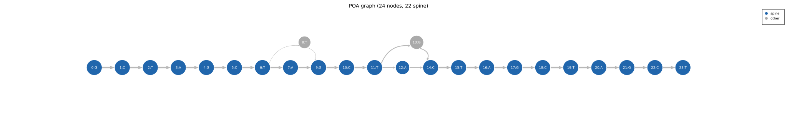
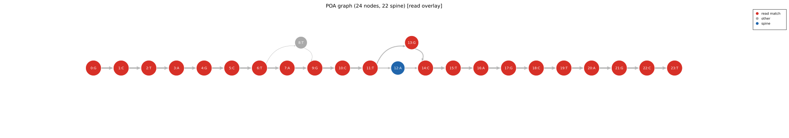
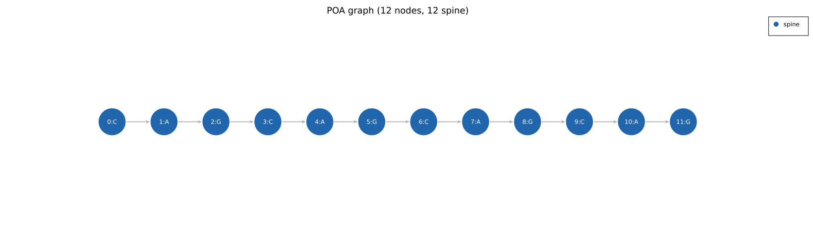
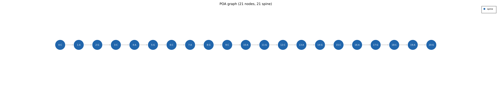
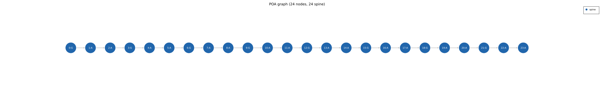
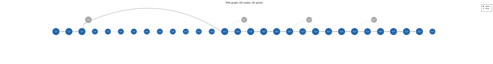

# Multi-Allele Phasing

A single graph built from reads covering two haplotypes contains both alleles
simultaneously. The graph has **bubble** structures at every position where the haplotypes
differ. `consensus_multi` recovers per-allele consensuses by partitioning the reads into
haplotype groups and rebuilding a separate consensus for each group.

The pipeline is a hybrid of two signals:

1. **Structural proposal**: length-changing bubbles propose an initial split.
2. **Linkage refinement**: each proposed group is searched for further splits using
   differences that co-occur on the same reads.
3. **Confirm and merge**: every pair of resulting groups must pass a distinctness test,
   or the two are merged.
4. **Per-allele rebuild**: each surviving group gets its own graph and consensus.

## Read-support thresholds

Two floors are used, both derived from `min_allele_freq` (default 0.2) and the read count
`n`:

| Floor | Formula | Used for |
|---|---|---|
| Bubble arm floor | `max(ceil(n * min_allele_freq), 1)` | finding structural and SNP bubbles for the proposal |
| Phasing floor | `max(ceil(n * min_allele_freq), 2)` | het sites in linkage phasing, and the minimum size of a called allele |

With 20 reads both are 4: an arm or allele needs at least 4 reads. Arms below the floor
are treated as noise. Bubble counting only uses *matched* adjacencies, so the edge a short
allele takes to bypass a longer allele's extra sequence does not look like a competing arm.
(The `GraphStats` / `bubble_sites` reporting on a single consensus uses a slightly looser
`max(floor(n * min_allele_freq), 1)`.)

`min_allele_freq` is a hard sensitivity boundary: an allele below it is merged into the
majority and does not appear in the output. Lower it to look for mosaics; raise it (~0.4)
on noisy ONT data.

## 1. Structural proposal

A **structural bubble** is one where at least one arm spans `phasing_bubble_min_span`
bases (default 10). A CAG×20 vs CAG×30 difference creates a 30-base arm that easily
clears this; a sequencing error creates a 1-node arm that does not.

- If structural bubbles exist, reads are clustered by the arms they take across all of
  them, with length used to place ambiguous reads. Clusters smaller than `min_reads` are
  merged into the largest cluster. When there are two or more structural bubbles, a
  validation pass also keeps a cluster only if it is length-separated from, and cleanly
  distinguished by a bubble from, every other cluster.
- If none are found on the banded graph, the graph is rebuilt **unbanded** and the search
  repeated once.
- If there is still no structural bubble, the single SNP-scale bubble with the most
  balanced support (largest minority arm) splits the reads by arm.
- With no qualifying bubble at all, the proposal is one group containing every read.

The proposal is only a starting point: steps 2 and 3 can split it further or undo it.

## 2. Linkage refinement

Each proposed group with at least `2 × min_reads` reads is rebuilt as its own graph and
searched for a split:

- **Het-site matrix.** A het site is a fork with at least two branches each carrying the
  phasing floor. Node fusion makes substitutions forks too, so SNPs, indels and length
  differences are all captured. Each read's call at a site is the branch its path takes.
  Paths here include the delete-bypass edges, because a shorter allele's divergence *is*
  the bypass.
- **Dominant bipartition.** A lightweight iterative two-way clustering finds the read
  partition most consistent across all sites. A real allele is a set of differences that
  co-occur on the same reads; independent sequencing errors do not line up this way.
- The split is kept only if both sides have at least `min_reads` reads and the two sides
  pass the distinctness test below. Accepted halves are refined again, up to three levels
  deep, so more than two alleles can be found.

Linkage refinement finds splits the structural step misses (for example a folded periodic
repeat diploid where no long arm surfaces, or a third allele hiding inside a structural
group).

## 3. Confirm and merge

Any two groups that are not **distinct** are merged, and the check repeats until every
remaining pair is distinct. Two groups are distinct only if:

- **Frequency floor**: the smaller group has at least the phasing floor computed over the
  whole locus. This rejects a small stutter or partial-read cluster whose length falls in
  the valley between two real alleles.
- and then **either** a length split:
  - the median read lengths differ by at least 8 bp **and** by at least 3 × the larger
    median absolute deviation (at least 3 bp), **and**
  - the median gap is at least **12 bp**;
- **or** a substitution split (same length, length gives no signal):
  - the two per-group consensuses differ in length by at most 2 bp and differ by at least
    one edit;
  - on a pooled graph of both groups, there is at least one informative het site and the
    partition's consistency is at least **0.85** (a clean haplotype split is near 1.0;
    error sub-clusters of one allele are around 0.7).

## 4. Per-allele consensus

Each final group is rebuilt from scratch: its own median-length seed, its own graph, and
the **heaviest-path** consensus with boundary trim. The coverage floor is computed from the
**group's** read count, not the total: with 20 reads split 10/10 the floor is 6, not 11.

Two behaviours differ from single-allele `consensus()`:

- `consensus_mode` is ignored: per-allele calls are always heaviest path, never best fit
  or majority frequency.
- Homopolymer handling is switched off for multi-allele calls.

`read_indices` in each returned `Consensus` lists (sorted) the input read indices assigned
to that allele, so callers can attach per-read metadata to the correct haplotype. When only
one group survives, a single consensus is returned with `read_indices` set to all
non-empty reads.

## Depth requirements

`consensus_multi` returns `Err(InsufficientDepth)` if fewer than `min_reads` (default 3)
non-empty reads are given. Groups below `min_reads` are not normally produced (the
proposal merges them away and linkage refinement will not create them); if one ever
reaches the rebuild step, the call returns `Err(InsufficientDepth)` for that group rather
than a low-depth allele.

For reliable two-allele calls, a minimum per-allele depth of 5-10 is recommended. At
depth 3, a single error read equals 33% frequency.

## Example: two-allele SNV bubble graph

The graph below was built from 20 reads split evenly between two alleles with a SNV at
position 11. The spine (blue) follows allele A; the grey arm is allele B. A minor noise
arm (single read with a sequencing error) is also visible.

With one allele-B read overlaid (orange), you can see exactly which nodes it traverses
through the bubble and which nodes it shares with allele A:

## Example: repeat expansion alleles

For repeat loci, alleles differ in the number of repeat units rather than a single base.
Each allele is rebuilt separately after phasing. The two graphs below compare normal and
pathogenic CAG alleles (modelled at reduced scale for clarity; real HTT expansions reach
36+ units for disease onset).

**Normal allele: (CAG)×4 = 12 bp**

**Pathogenic allele: (CAG)×7 = 21 bp (+3 units)**

The same pattern applies to the GAA repeat (Friedreich's ataxia, FXN intron 1).
Disease range is >66 units; scaled to 4 vs 8 units here.

**Normal allele: (GAA)×4 = 12 bp**

**Pathogenic allele: (GAA)×8 = 24 bp (+4 units)**

Note that at this toy scale the length difference (9-12 bp) is at or below the 12 bp
length-split floor; real expansions differ by tens of bases or more.

## Example: RFC1-style mixed read set

The CANVAS locus (RFC1 intron 2) is a 5-mer repeat where the normal allele is (AAAAG)×N
and a common pathogenic allele is (AAAGT)×N. The two motifs are 2 substitutions apart per
5-mer, so within the shared region the aligner places mismatches (fused sibling nodes)
rather than indels. The extra units of an expanded pathogenic allele extend past the end
of the shorter reads.

The graph below was built from 15 reads of (AAAAG)×4 (75%, normal) and 5 reads of
(AAAGT)×6 (25%, pathogenic minority). The first 20 positions are shared by all reads; the
last 10 come only from the 5 pathogenic reads.

What the current engine returns for this read set (default configuration):

- `consensus()` returns the 20 bp normal allele `(AAAAG)×4`. The 10-base tail has coverage
  5, below the strict-majority floor of 11, so boundary trim removes it. Four bubble sites
  (15 vs 5 reads) are reported at the motif substitutions.
- `consensus_multi()` also returns a **single** allele. The minority group (5 reads) clears
  the phasing floor of 4, but the median length gap is 10 bp, below the 12 bp length-split
  floor, and the two groups' consensuses differ in length by more than 2 bp, so the
  substitution test does not apply either. The groups are merged.

At realistic scale (tens of extra units) the length gap clears the floor and the alleles
split. For short or motif-only differences like this toy case, inspect `bubble_sites` and
use flank anchoring (`consensus_multi_flanked`) where possible.

## Known limitation

Periodic-repeat phase ambiguity pollutes the het-site matrix, so SNP haplotypes on
repeats, close repeat-count alleles and skewed minority alleles remain hard. Flank-anchored
preprocessing is the intended fix; see
[Flanking-Anchor Preprocessing](../library/flanking-anchor.md).
