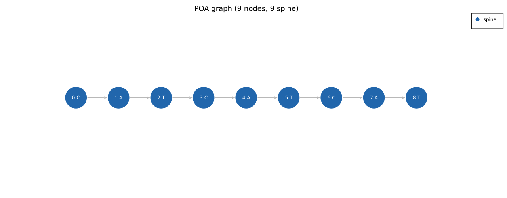

# Algorithm Overview

The algorithm runs in three stages for each read set:

1. **Seed initialisation**: a seed read becomes a linear chain of nodes. Every subsequent
   read is aligned into this growing graph. `consensus()` and `consensus_multi()` self-seed
   on the median-length read internally, so the result does not depend on which index the
   caller passes (`seed_idx` is only bounds-checked).
2. **Iterative alignment**: for each read: (a) topological sort, (b) full partial-order
   affine DP alignment against the graph within an adaptive static-diagonal band, (c) update
   the graph from the alignment traceback.
3. **Consensus extraction**: compute both a heaviest-path consensus and a
   majority-frequency (MSA-column) consensus, trim low-coverage boundaries, and return the
   one the reads better support (best-fit) along with coverage and statistics. By default,
   homopolymer-aware candidates are then tried inside homopolymer runs (see
   [Consensus Extraction](consensus-extraction.md#homopolymer-handling)).

## Example: linear consensus graph

A set of 5 identical `CATCATCAT` reads produces a 9-node linear chain. Every node is on
the spine (blue); all edge weights equal 5. This is the simplest possible POA graph: no
variants, no arms.

## Example: graph after 10 reads with one mismatch

After adding 10 reads where one read has a G at position 4 instead of C, the graph gains
a single-node arm at that position. The spine stays on the majority base (C, 9 reads);
the arm node (G, 1 read) branches off and rejoins. This is a **bubble**: two arms through
the same entry and exit nodes. The G node is recorded as an *aligned sibling* of the C
node, so both sit in the same MSA column.

## Data structures

### Node

Each node carries:

- `base`: the nucleotide at this position
- `out`: outgoing edges, each a target node and a weight (how many reads traversed it)
- `inc`: predecessor node indices
- `aligned`: sibling nodes in the same alignment column (alternative bases at a position)
- `cov`: number of reads that matched this node
- `del`: number of reads that skipped this node with a delete

Every read that steps from one node to the next increments that edge's weight, including
the edge a read takes to rejoin the graph after a deletion.

### Internal graph

The graph owns all nodes in a flat `Vec<Node>`. Node indices are stable (nodes are only
appended); topological order is recomputed before each alignment. Per-read provenance is
kept alongside: the nodes each read occupies (`read_paths`) and its matched-only
adjacencies (`read_matched_edges`), which drive bubble reporting and multi-allele phasing.
The banded aligner centres its DP band using a static-diagonal-union corridor derived from
graph geometry (see [Banded DP Alignment](banded-dp.md)). This graph is an internal
construction detail: the public API is purely functional (`consensus`, `consensus_multi`,
`consensus_flanked`, `bridged_consensus`, ...), so callers never handle the graph directly.

## Alignment scoring

| Operation | Score |
|---|---|
| Match | +2 |
| Mismatch | -4 |
| Gap open | -4 (once per gap) |
| Gap extend | -3 (per gap base, including the first) |

A gap of length `k` costs `gap_open + k * gap_extend`, so a 1-base gap costs -7 and a
4-base gap costs -16. Affine gaps are used from the start: the three-state recurrence
(M/I/D matrices) charges gap-open separately from gap-extend, giving meaningfully better
accuracy on homopolymer runs than linear penalties would. Inside homopolymer runs the
default configuration uses cheaper gap costs (`homopolymer_gap`, -2 / -1) when building
its homopolymer candidate; see
[Consensus Extraction](consensus-extraction.md#homopolymer-handling).

## Critical design decisions

These choices are load-bearing. Changing them without understanding the tests is likely to
break things.

**Delete ops do not increment coverage.** A read that skips a node via a delete increments
that node's `del` count, not its `cov`. Skipping is not evidence for the base, so nodes that
most reads skip keep low coverage and boundary trim can remove them.

**Mismatches become sibling nodes (node fusion).** A mismatched read base is stored as a
substitution node aligned to the same column, or merged into an existing sibling with the
same base. Without this the read's base would be lost and a majority substitution could
never win over the seed's base.

**The seed is the median-length read.** The engine picks it itself. A seed that is much
longer or shorter than the read set biases a periodic repeat toward the outlier's length.
Seed selection helpers remain available for callers who build their own pipelines (see
[Seed Selection](../library/seed-selection.md)).

**Semi-global alignment for STR reads.** Global alignment has a subtle failure mode at
homopolymer-flanked loci. Use `AlignmentMode::SemiGlobal` (the default) for extracted STR
reads. See [Single-Allele Consensus](../library/single-allele.md) for details.
